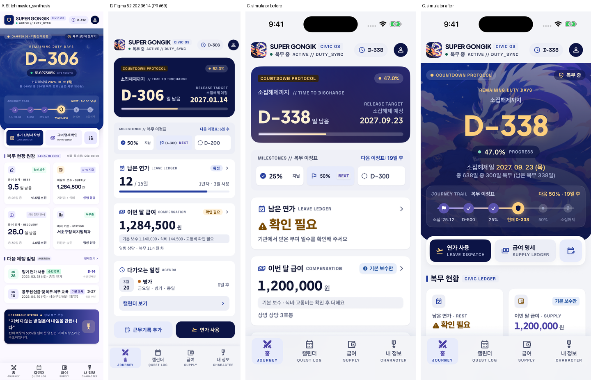
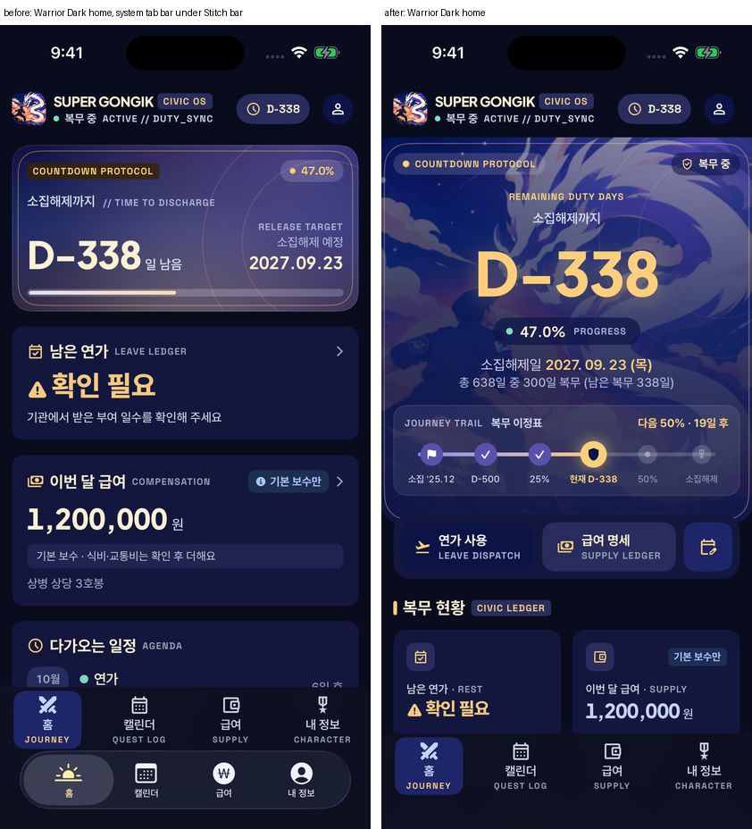

# Stitch real fidelity audit (2026-10-20)

[STITCH-FIDELITY-AUDIT.md](./STITCH-FIDELITY-AUDIT.md) and
[SCREEN-MAP.md](./SCREEN-MAP.md) marked 홈 and the tabs **MATCH**. The owner's
phone disagreed. This audit compares three things separately instead of
trusting those marks:

- **A** — the original Stitch export (`~/Downloads/stitch_super_gongik_rpg_redesign.zip`:
  `screen.png` + `code.html` per view; 54 views plus `screen_matrix.md`,
  `stitch_context.md`, `design.md`).
- **B** — Figma page 52 production frames (e.g. 홈 `202:3614`).
- **C** — the app on an iPhone 16 simulator, iOS 26.3, `-SGSeedDemo YES`.

Build provenance (what the phone ran) is in
[../ios/BUILD-PROVENANCE-AUDIT.md](../ios/BUILD-PROVENANCE-AUDIT.md): the phone
most likely ran the same code as `main`, so the gap below is a design gap,
not a stale install.

Evidence: [`qa-2026/stitch-real-fidelity/`](./qa-2026/stitch-real-fidelity/).

## Why the app did not look like Stitch

1. **The wrong Stitch screen was the target.** The implementation plan named
   `direction_b_civic_codex` the base and listed `master_synthesis`,
   `epic_duty_hero` and `rpg_civic_odyssey` only as "home states; hero
   illustration". Direction B is an early direction study: a compact navy
   countdown card on a white page. Every later home in the set — master
   synthesis, epic duty hero, fullscreen hero, the dark HUDs — converged on a
   **full-bleed night-sky hero with the agent and S-dragon artwork, a 64 pt
   gold D-day, a journey trail stepper, an action tray overlapping the hero
   and a 2 × 2 ledger grid**. None of that was built; the hero illustration
   was never used on 홈. Those big, atmospheric elements are what makes the
   Stitch set read as Stitch, so the app looked like a different design even
   though the small details (fonts, icons, tags, tab bar) matched.
2. **Figma was redrawn from the code.** PR #69 redrew page 52 to the PR #68
   app. B matched C because B copied C; "Figma = code" was then read as
   "code = Stitch". The three-way image above shows B and C agreeing with each
   other and both differing from A.
3. **The iOS 26 system tab bar could reappear.** `RootView` used a `TabView`
   with `.toolbar(.hidden, for: .tabBar)` on each tab. On the Warrior Dark 홈
   the system Liquid Glass bar (sun / calendar / W / person glyphs) rendered
   **under** the Stitch bar — the pre-Stitch navigation look.
   
4. **Standard vs Warrior was not the cause.** Since PR #68 both themes show
   the world labels, fonts, icons and the Stitch tab bar; Warrior only adds
   the gilded crest and section bars and shifts the palette. A fresh install
   gets Standard (`ThemePreference.load`), which already had the full Civic
   Codex structure. Nothing about the default theme needed migrating; an
   explicit stored choice is left alone.
5. **Version numbers could not show any of this.** Every build was
   `0.1.0 (1)`.

## Status by screen

Statuses: `MATCH`, `VISUAL_MISMATCH`, `FUNCTIONAL_MISMATCH`,
`BUILD_VERSION_MISMATCH`, `INTENTIONAL_DEVIATION` (with the reason),
`NOT_IMPLEMENTED`. "Before" is `main` `9f86409`; "after" is this PR.

### 홈 (A: `super_gongik_master_synthesis`; `epic_duty_hero` for the same layout)

| Element                                                               | Before                                           | After                 | Notes / where                                                                                                                                                                                                               |
| --------------------------------------------------------------------- | ------------------------------------------------ | --------------------- | --------------------------------------------------------------------------------------------------------------------------------------------------------------------------------------------------------------------------- |
| App header (mark, SUPER GONGIK, CIVIC OS, state, D-day pill, profile) | MATCH                                            | MATCH                 | `Features/Common/AppHeader.swift`                                                                                                                                                                                           |
| Full-bleed hero, rounded only at the bottom (32 pt)                   | VISUAL_MISMATCH (inset card, 20 pt all corners)  | MATCH                 | `JourneyHero` in `Features/Today/TodayView.swift`                                                                                                                                                                           |
| Hero artwork (agent + S-dragon, screened ~40 %, scrim to the bottom)  | NOT_IMPLEMENTED                                  | MATCH                 | Uses the app's own `CardArt` (the brand icon artwork). Stitch's dragon image is a generated placeholder hosted on googleusercontent and is not used                                                                         |
| Chapter pill (leading) / state pill (trailing)                        | NOT_IMPLEMENTED                                  | MATCH (structure)     | INTENTIONAL_DEVIATION on wording: "CHAPTER 02 · 지평선의 관문" and "복무 2단계 도약기" are invented chapters; the pill shows the phase's world tag (COUNTDOWN PROTOCOL / PROLOGUE / FINAL QUEST) and the core's state label |
| "REMAINING DUTY DAYS" + 64 pt gold centred D-day with glow            | VISUAL_MISMATCH (40 pt ivory, left)              | MATCH                 | Korean eyebrow (소집해제까지) kept under the world label                                                                                                                                                                    |
| Percent pill "51.92 % LIVE RECORD"                                    | VISUAL_MISMATCH                                  | MATCH                 | "LIVE RECORD" only when the per-second readout is on; otherwise "PROGRESS"                                                                                                                                                  |
| 소집해제일 date (gold) + "총 N일 중 M일 복무 (남은 복무 K일)"         | NOT_IMPLEMENTED                                  | MATCH                 | From `hero.totalServiceDays / elapsedDays / remainingDays`                                                                                                                                                                  |
| Journey trail stepper (소집 → passed → 현재 → next → 소집해제)        | VISUAL_MISMATCH (three chips outside the hero)   | MATCH                 | `JourneyTrail` (unit-tested); route milestones only                                                                                                                                                                         |
| Launchpad tray overlapping the hero (primary navy, secondary, square) | VISUAL_MISMATCH (two buttons at the bottom)      | MATCH                 | INTENTIONAL_DEVIATION on wording: "휴가 신청서 작성" would imply filing with an institution → 연가 사용 (opens the editor with 연가); 급여 명세 opens 급여; the square is 근무기록 추가 instead of cloud sync               |
| Section header: accent bar + title + world tag                        | VISUAL_MISMATCH (bar in Warrior only)            | MATCH                 | Bar drawn in both themes                                                                                                                                                                                                    |
| 2 × 2 ledger: 잔여 연가 · REST, 이달의 보수 · SUPPLY                  | VISUAL_MISMATCH (full-width cards)               | MATCH                 | Badges stay honest: 확정 / 계산됨 / 기본 보수만, never 검증 완료                                                                                                                                                            |
| Ledger tile 잔여 병가 · RECOVERY                                      | NOT_IMPLEMENTED                                  | INTENTIONAL_DEVIATION | The core has no sick-leave balance; the tile shows 복무한 날 · PROGRESS from the core instead                                                                                                                               |
| Ledger tile 배치 기관 · STATION, "담당관 승인 · 정상 인가"            | NOT_IMPLEMENTED                                  | INTENTIONAL_DEVIATION | The app does not hold an institution name, and approval states are excluded by the plan; the tile shows 다음 이정표 · NEXT                                                                                                  |
| "최종 동기화: 오늘 09:00"                                             | NOT_IMPLEMENTED                                  | NOT_IMPLEMENTED       | Only meaningful with cloud sync on; left for the cloud screen                                                                                                                                                               |
| Agenda: white row cards, date tile, D-N on the right, 전체보기        | VISUAL_MISMATCH (rows inside one card, "N일 후") | MATCH                 | `AgendaSection`, `AgendaRow`                                                                                                                                                                                                |
| HONORABLE STATUS banner                                               | NOT_IMPLEMENTED                                  | MATCH (structure)     | INTENTIONAL_DEVIATION on wording: no "honorable status"; "JOURNEY NOTE · 전체 복무의 47.0%를 지나왔어요" from real progress                                                                                                 |
| Status bar over scrolled content                                      | FUNCTIONAL_MISMATCH (text under the clock)       | MATCH                 | Canvas strip behind the status bar, `RootView`                                                                                                                                                                              |
| Tab bar                                                               | FUNCTIONAL_MISMATCH (system bar could show)      | MATCH                 | `RootView` no longer uses `TabView`                                                                                                                                                                                         |

Evidence: [home-stitch-before-after.png](./qa-2026/stitch-real-fidelity/home-stitch-before-after.png),
[home-lower-after.png](./qa-2026/stitch-real-fidelity/home-lower-after.png),
[themes-after.png](./qa-2026/stitch-real-fidelity/themes-after.png).

### 캘린더 (A: `super_gongik_calendar_quest_log`)

| Element                                                               | Status                | Notes                                                                                           |
| --------------------------------------------------------------------- | --------------------- | ----------------------------------------------------------------------------------------------- |
| Header, title + QUEST LOG tag, 오늘 / + / …                           | MATCH                 |                                                                                                 |
| Month switcher card + OPERATION CYCLE                                 | MATCH                 |                                                                                                 |
| Month summary row (4 counts)                                          | MATCH                 | Counts records, not days (decided in phase 2)                                                   |
| Grid: rounded tiles, Sat blue / Sun red, neighbours muted, today navy | MATCH                 |                                                                                                 |
| Holidays in red / 공휴일 legend                                       | INTENTIONAL_DEVIATION | No holiday calendar in the core                                                                 |
| Selected-day detail card with CONFIRMED / 결재 / AUTH numbers         | INTENTIONAL_DEVIATION | Approval states excluded by the plan                                                            |
| 다가오는 퀘스트 일정 list under the grid                              | VISUAL_MISMATCH       | The app shows the list in the 목록 segment instead of under the month; not changed in this pass |
| CIVIC INVENTORY strip at the bottom                                   | VISUAL_MISMATCH       | Present as the top summary row rather than a navy bottom strip; not changed                     |

### 급여 (A: `super_gongik_supply_compensation`)

| Element                                                       | Status                | Notes                                                                                             |
| ------------------------------------------------------------- | --------------------- | ------------------------------------------------------------------------------------------------- |
| Header, SUPPLY // payroll eyebrow, month switcher             | MATCH                 |                                                                                                   |
| Navy estimate card with the component tiles                   | MATCH                 | Stitch shows a dark page; the app keeps the light canvas in Standard Light (Warrior Dark is dark) |
| Itemised ledger rows (기본 / 식비 / 교통비) with explanations | MATCH                 | Values only when the core knows them; otherwise 입력 필요                                         |
| "VERIFIED" / 확정 지급 marks                                  | INTENTIONAL_DEVIATION | The app never claims verification                                                                 |
| 호봉 progression stepper                                      | NOT_IMPLEMENTED       | Not changed in this pass                                                                          |

### 내 정보 (A: `super_gongik_character` — its `screen.png` in the export is empty; checked against `code.html`)

| Element                                                  | Status | Notes                                                      |
| -------------------------------------------------------- | ------ | ---------------------------------------------------------- |
| Header + 내 정보 · CHARACTER                             | MATCH  |                                                            |
| Navy character card with art, progress and four stats    | MATCH  | Name/rank/ID/institution not drawn (no data / rule)        |
| Grouped settings with Material glyphs and world sections | MATCH  |                                                            |
| Build provenance rows (버전, 빌드, 화면 테마)            | new    | Not in Stitch; needed so a phone's build can be identified |

### Other screens

Not re-captured in this pass (they were not part of the reported gap and the
host had a load average of 50–80 during the session): onboarding, record
editor sheet, cloud screens, memorial card, widgets, Live Activity. Their
status stays as recorded in `STITCH-IMPLEMENTATION-PLAN.md` § Status, which
was verified against the Figma frames, not against A. Treat them as
**unaudited against A**.

## Verification

- Swift package: `swift test` — 53 tests in 12 suites passed.
- App: `xcodebuild test` on the iPhone 16 simulator — 20 tests in 8 suites
  passed, including the new `JourneyTrail` suite.
- Screenshots: Standard Light/Dark and Warrior Light/Dark on 홈, plus 캘린더 /
  급여 / 내 정보; the system tab bar did not appear in any of them.
- kolint `--genre ux` on the new Korean strings: 0 findings.

## Remaining differences

- 캘린더: agenda under the grid and the bottom inventory strip.
- 급여: dark page treatment in Standard, 호봉 stepper.
- No Reduce Motion / VoiceOver pass on a device for the new hero.
- iPhone SE and 16 Plus, Accessibility XXL and the pre-service, D-7,
  discharge-day and completed states of the new hero were not captured in
  this session; the layout has explicit accessibility-size branches (trail as
  a list, launchpad stacked, one-column ledger) that still need a screenshot
  check. CI's `screenshot-qa.sh` matrix covers SE, 16 Plus and XXL.
- Figma page 52 still shows the old 홈; redraw it from A, not from C.
